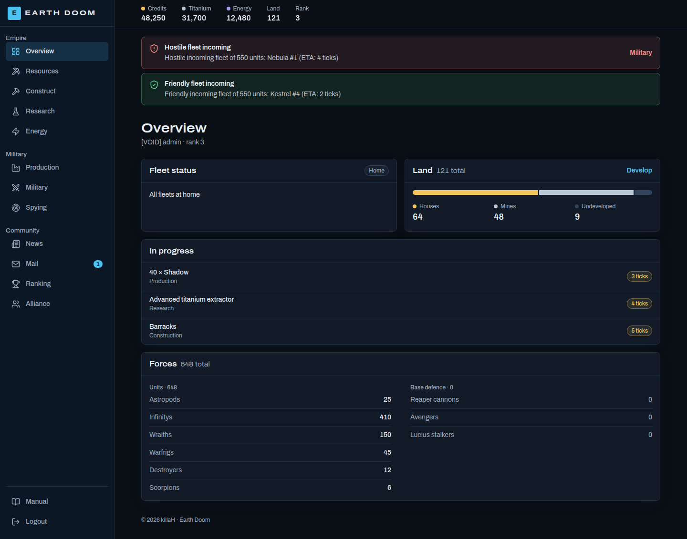

[](https://codecov.io/gh/w3bdesign/earthdoom)


## This game is under active development and may have bugs

## Earthdoom



Earthdoom is a full-stack web-based strategy game built using Typescript, Next.js, React, tRPC, Tailwind, Prisma and more.

The database is handled through PostgreSQL.

Authentication is handled through Clerk.

The front page (earthdoom.com) is built with Astro 7 and lives in `/blog`.

The application is designed with a modern, responsive and intuitive user interface.

## Technologies used

- [Next.js](https://nextjs.org)
- [Prisma](https://prisma.io)
- [Tailwind CSS](https://tailwindcss.com) v4
- [tRPC](https://trpc.io)
- [React Hot Toast](https://react-hot-toast.com)
- [React Chart.js](https://react-chartjs-2.js.org)
- [Clerk](https://clerk.com)
- [Astro](https://astro.build)
- [Jest](https://jestjs.io)
- [Zod](https://github.com/colinhacks/zod)

## Table of Contents

- [Installation](#installation)
- [Usage](#usage)
- [Scripts](#scripts)
- [Contributing](#contributing)
- [License](#license)

## Installation

To install the required dependencies, simply run the following command in the project's root directory (/game):

```bash
npm install
```
Copy `.env.example` to `.env` and fill in a PostgreSQL connection string (`DATABASE_URL`) and your Clerk keys.

## Usage

To start the development server, run the following command:

```bash
npm run dev
```

The application will be available at `http://localhost:3000`

## Scripts

This project includes the following npm scripts for development and building:

- `build`: Builds the application for production.
- `dev`: Starts the development server.
- `postinstall`: Generates Prisma client after installing dependencies.
- `lint`: Lints the codebase using ESLint.
- `lint:fix`: Lints the codebase and fixes what ESLint can fix automatically.
- `test`: Runs the test suite with Jest.
- `start`: Starts the production server.
- `prisma:generate`: Generates the Prisma client.
- `format`: Formats the codebase using Prettier.
- `refresh`: Removes node_modules, package-lock.json, installs dependencies, and formats the codebase.

## Contributing

If you'd like to contribute to the development of Earthdoom Game, please follow these steps:

1. Fork the repository.
2. Create a new branch with a descriptive name.
3. Make your changes and commit them with clear and concise commit messages.
4. Push your changes to your forked repository.
5. Open a pull request with a description of the changes you've made.

## License

This project is licensed under the [GNU Affero General Public License v3.0](LICENSE).
